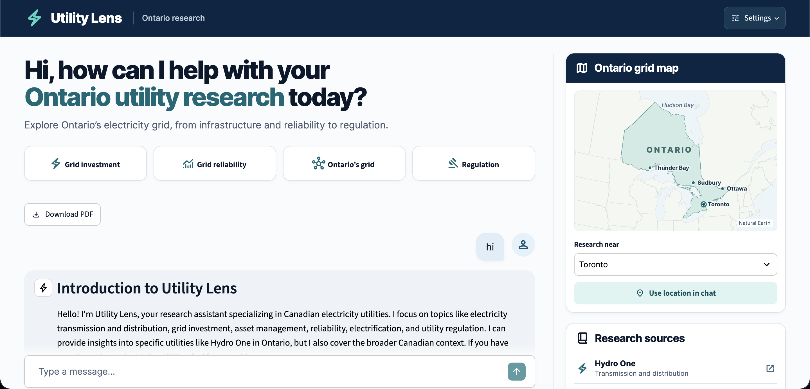
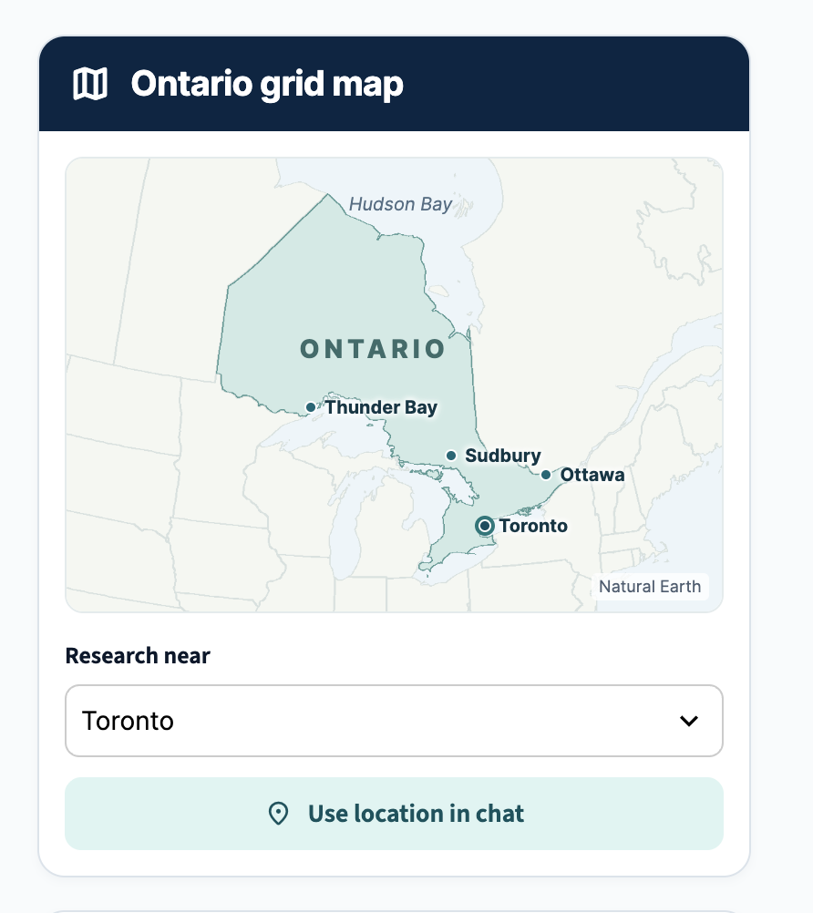
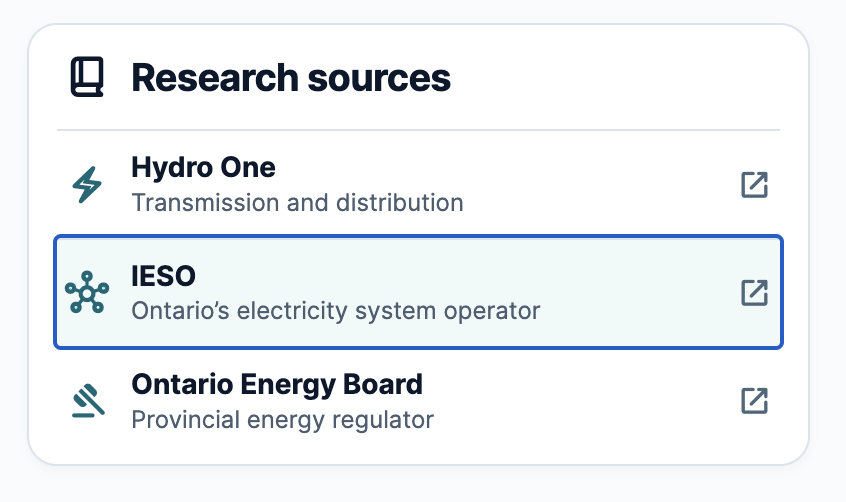
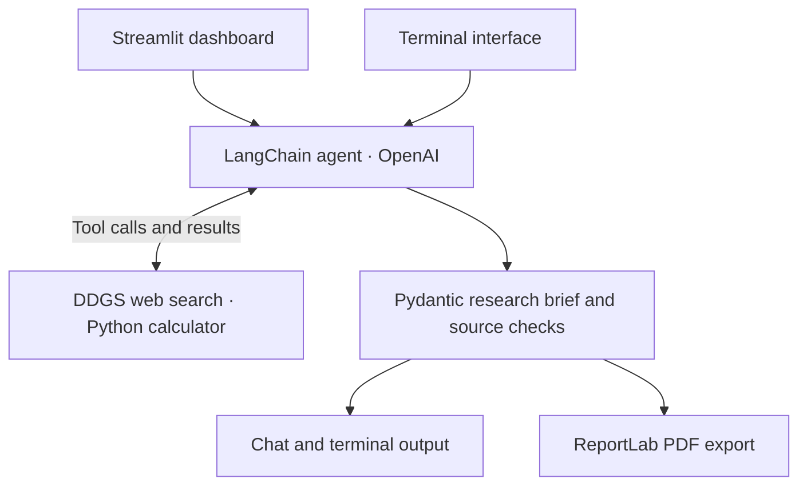

# Utility Lens

**A research assistant for Ontario’s electricity grid and Canadian utilities.**

Utility plans, reliability reports, and regulatory decisions are published across different sites. Utility Lens helps you find the relevant sources, ask follow-up questions, and turn your research into a PDF brief with clickable citations.

[Interface](#interface) · [Demo walkthrough](#demo-walkthrough) · [Run locally](#run-locally) · [Architecture](#architecture)

## Interface



**Research dashboard.** Start with a grid investment, reliability, grid roles, or regulation shortcut, or write your own question. The dashboard keeps the conversation, Ontario map, and research references in view.

### Research an Ontario city



**Ontario city picker.** Choose Toronto, Ottawa, Sudbury, or Thunder Bay. **Use location in chat** drafts a question about the utilities and planned grid investments near that city. You can edit the draft before sending.

### Open an official source



**Official research sources.** Open Hydro One, the Independent Electricity System Operator (IESO), or the Ontario Energy Board directly from the dashboard. The **Sources** tab in each brief lists the links cited for that answer.

## Demo walkthrough

1. Pick **Sudbury** on the map, click **Use location in chat**, and send the drafted question. Try asking about another Canadian utility directly in chat to research outside Ontario.
2. Read the brief and **Key takeaways**. Open **Sources** to check the citations and **Research activity** to see the searches and calculations the agent ran.
3. Ask a follow-up such as “Which of these projects have regulatory approval, and when are they expected to enter service?” The agent uses recent turns and their recorded sources for context.
4. Click **Download PDF** to save the conversation, findings, and source links. To start a fresh conversation, select **Settings → New research**.

In **Settings**, choose **Quick brief** for a focused first pass or **Deep research** for a more detailed investigation with a larger step budget. You can also change the model or toggle web search and the calculator.

## Run locally

You’ll need **Python 3.11 or later**, an internet connection, and an OpenAI API key to run research.

```bash
git clone https://github.com/abrartarafder/utils-research.git
cd utils-research
python3 -m venv .venv
source .venv/bin/activate
python -m pip install -r requirements.txt
python -m streamlit run app.py
```

On Windows PowerShell, create and activate the environment with `py -3 -m venv .venv` and `.\.venv\Scripts\Activate.ps1`. Then run the same install and launch commands.

Open the URL printed in the terminal, usually [http://localhost:8501](http://localhost:8501). Enter your key under **Settings → OpenAI API key**, or copy [.env.example](.env.example) to a local `.env` file and set `OPENAI_API_KEY` there. `OPENAI_MODEL` controls the default model and falls back to `gpt-4o`. A key entered in Settings takes priority for that session.

### Terminal mode

With `OPENAI_API_KEY` configured in `.env` or your shell environment, run an interactive session or ask a single question using the same research workflow.

```bash
python main.py
python main.py --deep "What grid investments are planned near Sudbury, Ontario?"
```

## Architecture



- **Research.** The agent can refine web searches and use a local arithmetic tool. The research prompt asks it to prioritize primary sources, align reporting periods and units, and distinguish proposed, approved, and in-service projects.
- **Structured results.** Pydantic validates the response shape. The workflow checks citations against links returned by search or recorded in recent conversation history.
- **Conversation context.** Each request includes up to 24 recent messages and their recorded sources. The full session remains available for PDF export.

| File | Responsibility |
| --- | --- |
| [`app.py`](app.py) | Streamlit dashboard, map, settings, conversation, and export controls |
| [`research.py`](research.py) | Agent configuration, research loop, citation filtering, and PDF rendering |
| [`tools.py`](tools.py) | DDGS search and a calculator for bounded arithmetic |
| [`main.py`](main.py) | Terminal interface |
| [`assets/`](assets/) | Styles, Ontario basemap, and screenshots |

### Data and scope

Web search returns titles, URLs, and preview snippets. Citation checks track where a link came from. Open the original document to confirm claims, figures, and dates.

The app keeps conversations in session memory. Research sends the question, recent context, and tool results to OpenAI. DDGS sends queries to search providers. PDF export runs locally.

The Ontario map provides geographic context for research questions. Basemap data comes from [Natural Earth](https://www.naturalearthdata.com/).
